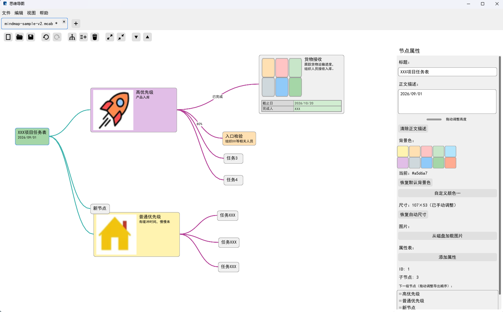

# mindcab

一款轻量级桌面脑图（思维导图）编辑器，使用 **Zig + dvui + SDL3** 构建，支持 Windows 和 Ubuntu 平台，中文界面。



## 功能特性

### 核心编辑
- **树形结构**：中心主题向右逐层展开，贝塞尔曲线连线；连线按层级着色（同层同色、每会话随机、不保存）
- **两级文本**：节点包含「标题」+ 可选「正文描述」，描述略小字号
- **就地编辑**：双击节点改标题，双击连线改连线标题
- **拖拽移动**：按住左键拖动节点，整个子树跟随
- **节点增删**：`Insert` 加子节点、`Enter` 加同级、删除节点及其子树
- **折叠/展开**：`+` 徽章逐层展开、「展开当前」一次展开整棵子树、「全部展开/折叠」
- **节点样式**：自定义背景色（预设色板/取色器/十六进制），深色自动白字、浅色黑字
- **手动调整尺寸**：拖拽右/下/右下边缘调宽/高，尺寸作下限、随文件保存、可一键恢复自动
- **撤销/重做**：`Ctrl+Z`/`Ctrl+Y`，每标签独立历史（50 步），覆盖增删移改折叠尺寸等操作

### 图片与属性
- **节点图片**：侧栏从磁盘加载（jpg/png），图片池按 MD5 去重、UUID 引用；点击图片区全窗口模态预览
- **节点属性**：任意数量键值对，侧栏增删改，节点框底部以表格渲染（灰名/绿值）
- **渲染布局**：有图片节点采用左右两列（左正方形图片区≥128×128、右标题+正文），无图片保持原布局
- **撤销支持**：图片/属性所有编辑纳入统一撤销会话

### 系统剪贴板
- **复制节点**：`Ctrl+C` 写入剪贴板，含图片则内联 Base64
- **粘贴智能分派**：`Ctrl+V` 按内容类型自动处理——节点 XML→新建同级节点、图片路径/位图→设为当前节点图片、普通文本→设为标题

### 多文档标签页
- 标签栏切换/关闭/新建，每标签独立状态（树、选中、滚动、未保存标记）
- 打开文件总进新标签，已打开则直接切换
- `Ctrl+Tab` / `Ctrl+PageDown/Up` 快捷切换

### 文件管理
- 新建/打开/保存/另存为
- 导出 PNG：整张脑图渲染为白底图片
- 未保存以 `*` 标记（标签栏+状态栏）

### 界面与体验
- 中文界面，内置中文字体，跟随系统深浅色主题
- 工具栏图标按钮（悬停提示功能名+快捷键）
- 状态栏显示：标签序号、文件名、节点数、操作提示
- 画布滚动，每标签记忆位置

## 快捷键

| 操作 | 快捷键 |
|------|--------|
| 新建标签 | `Ctrl+N` |
| 关闭标签 | `Ctrl+W` |
| 切换标签 | `Ctrl+Tab` / `Ctrl+PageDown` (下) / `Ctrl+PageUp` (上) |
| 添加子节点 | `Insert` |
| 添加同级节点 | `Enter` |
| 删除节点 | `Delete` |
| 撤销 | `Ctrl+Z` |
| 重做 | `Ctrl+Y` / `Ctrl+Shift+Z` |
| 复制节点 | `Ctrl+C` |
| 粘贴 | `Ctrl+V` |
| 全部展开 | `Ctrl+Shift+E` |
| 全部折叠 | `Ctrl+Shift+C` |

## 快速开始

### 环境要求
- [Zig](https://ziglang.org/) 0.17.0+
- Windows 10/11、Ubuntu 24（主要验证平台）
- SDL3、freetype 等依赖由构建系统自动处理

### 构建与运行
```bash
# 编译
zig build

# 运行
zig build run

# 跑单元测试（多文档标签逻辑）
zig build test
```
可执行文件输出至 `zig-out/bin/mindcab.exe`。

### 发布
默认 target 锁定 `x86_64_v2`（见 `build.zig`），Release 构建即可在别的机器跑：
```bash
zig build -Doptimize=ReleaseSmall
```
> 原因：老 CPU 的 native 会开启 XOP/FMA4/TBM 等 Intel 不支持、Zen 后移除的指令，导致非法指令崩溃。

需要更保守/更快可覆盖：
```bash
# 最保守：纯 SSE2，任意 x64 可跑
zig build -Doptimize=ReleaseSmall -Dcpu=baseline

# 2015 年后机器（AVX2/BMI2）
zig build -Doptimize=ReleaseSmall -Dcpu=x86_64_v3
```
